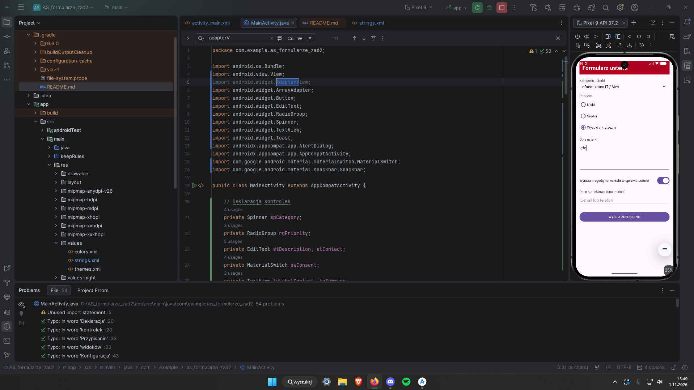

Który interfejs nasłuchiwania ma więcej niż jedną metodę?
SeekBar.OnSeekBarChangeListener (ma 3 metody)
Wynika z tego, że nie można użyć skróconego wyrażenia lambda (->). Zamiast tego trzeba napisać dłuższą konstrukcję z użyciem klasy anonimowej (new NazwaInterfejsu() { ... }) i jawnie zaimplementować w kodzie wszystkie wymagane przez dany interfejs metody, nawet jeśli niektóre z nich pozostaną puste.